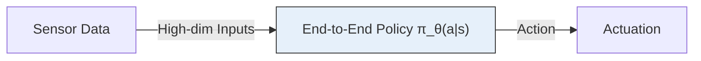
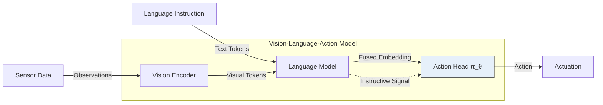
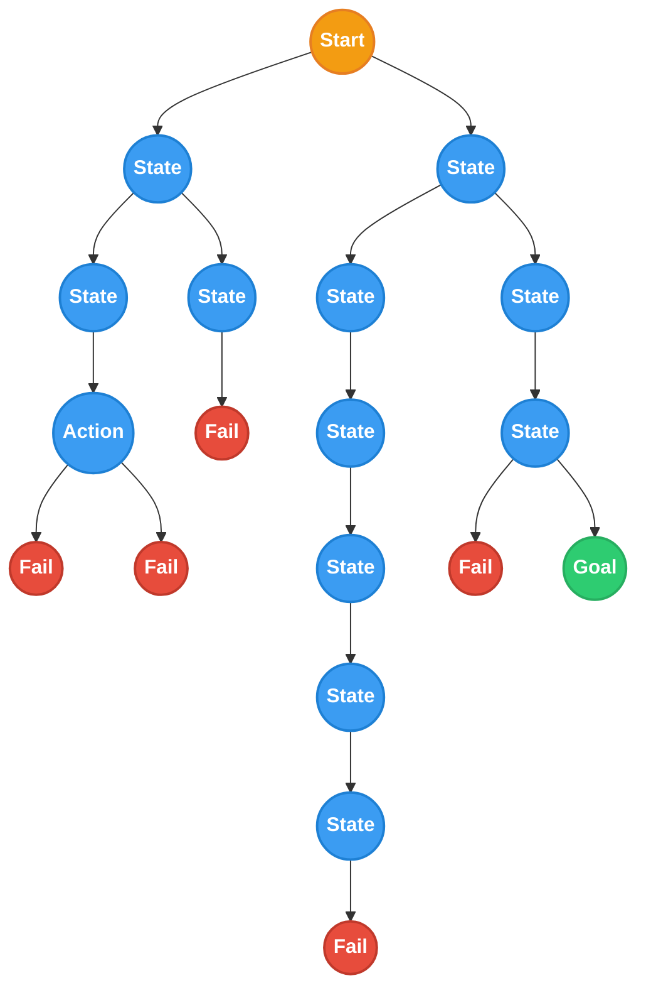
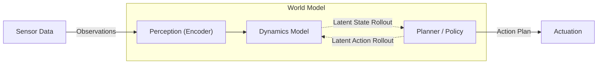

If you watch modern robots or autonomous agents in action today, you might think the problem of navigation and decision-making is largely solved. Many of these systems rely heavily on Imitation Learning or Behavior Cloning (BC). The concept is straightforward: show an AI thousands of hours of a human performing a task, and train the network to map the current camera view to the correct steering or joint angle. It looks magical. But there is a catch: it is essentially just muscle memory.

If you drive the exact same route to work every single day, you eventually do it on autopilot. But what happens if a tree falls across the road? Your muscle memory can't help you here. 

### The Illusion of Reasoning in VLAs

To handle more complex tasks, the robotics field has recently pivoted toward Vision-Language-Action (VLA) architectures. As illustrated above, these models pass observations through a vision encoder and language instructions through a language model. The resulting visual tokens and text tokens combine into a fused embedding that feeds into an action head.

Because we can guide these models with natural language, they appear to reason. But under the hood, this is still behavior cloning. **These are fundamentally greedy approaches: they select the best action by only considering the present moment.** The text instruction acts strictly as an instructive supervisory signal. It tells the robot what to accomplish, but it does so without grounding the policy in the causal consequences of its actions. A VLA knows what the steering angle should be when an image looks a certain way, but it cannot simulate what the scene will look like after turning the wheel.

### Dreaming to Plan: The World Model Paradigm
Going back to the road closure example. When you see the fallen tree, you have to stop, pull up a mental map of your city, and evaluate alternative routes to find a detour.  That deliberative, forward-looking process is Planning.

At its core, planning is the ability to search through a sequence of possible future actions to achieve a specific goal. Unlike greedy methods, planning considers the long-term impact of a chosen action. To do this effectively, the system requires two core components: a dynamics model (a world model) to simulate how the environment will change, and a defined goal (a cost function) to evaluate the desirability of those future states. In our fallen tree scenario, this cost function would heavily penalize hitting the obstacle while rewarding forward progress toward your office.

Rather than asking, "What action did the human take when the image looked like this?" a planning system asks, "If I take action $$a_1$$, followed by $$a_2$$, what will the world look like, and does that bring me closer to my goal?"

In classic artificial intelligence, planning is often represented as a search tree. The agent systematically explores branches of future possibilities, scores them based on some metric, for example, safety and efficiency, and executes the optimal path.

##### So why don't we use classic planning for everything? 
The "Pixel Problem": The roadblock that pushed many researchers toward behavior cloning is the sheer complexity of the real world.

Classic planning works exceptionally well in discrete, well-defined environments like a chessboard or the image above. But a robot operating in the real world doesn't see neat, discrete grids. It sees raw, continuous pixels. If an agent receives observations as high-dimensional images, a single state $$s$$ exists in a continuous space of $$\mathbb{R}^{H \times W \times C}$$.

Trying to perform search-based planning directly in this high-dimensional pixel space is computationally unfeasible. The branching factor is too large, and predicting exactly how every pixel will change after an action (e.g., simulating the lighting changes, shadows, and textures of a moving scene) wastes valuable compute on details that don't matter for the actual task.

#### Dreaming to Plan: The World Model Paradigm

To bring planning back to complex robotics, we need to teach the AI to dream in summaries (latent space), not in pixels. This is where World Models and Latent Planning come in.

Instead of trying to predict the exact visual future, we train a neural network to compress the high-dimensional visual input into a compact, low-dimensional representation called a latent state, $$z_t$$. We then train a dynamics model to predict the next latent state based on the current state and a chosen action:$$z_{t+1} = f(z_t, a_t)$$

By doing this, we strip away the noise, the exact texture of the grass, the reflection in a window, and preserve only the critical semantic and geometric information. Because this latent space is compact (and sometimes discrete), we can run expansive search algorithms again. The agent can "imagine" multiple potential futures in its latent space in a fraction of a second, find the best sequence of decisions, and then execute them using continuous control frameworks.

### Pioneering the Real-World Shift

While deliberative planning in continuous pixel space is notoriously difficult, we are beginning to see breakthroughs that prove it is possible. Two recent models represent exciting first steps toward planning in the real world for naviation: [Navigation World Models (NWM)](https://www.amirbar.net/nwm/index.html), and [Hydra](https://robotixx.github.io/hydra).

Both systems showcase how latent dynamic models allow us to reintroduce true forward-looking search into modern robotics. _(I will be doing a deeper dive into the specific architectures of Hydra and NWM in the future)_.

### The Future is Deliberative

Behavior cloning gave us a fantastic head start, providing baseline policies and getting robots moving. But muscle memory alone cannot yield true autonomy in dynamic, unstructured environments.

The real frontier for the next generation of robotics is not just collecting more human demonstrations to cover every edge case. It is about building AI that actually understands cause and effect. By developing robust world models that capture the true dynamics of the environment, we empower agents to imagine the consequences of their actions and solve completely novel situations on the fly. We are moving away from robots that just react, toward agents that truly reason.
